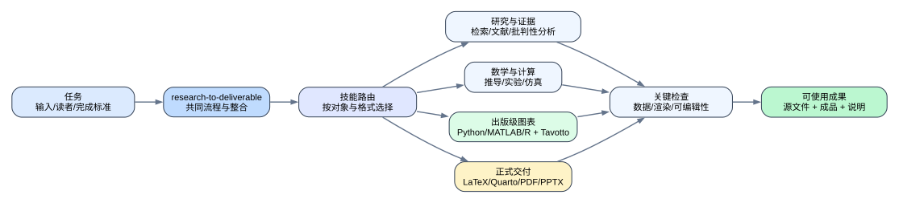
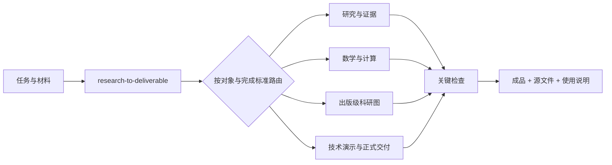
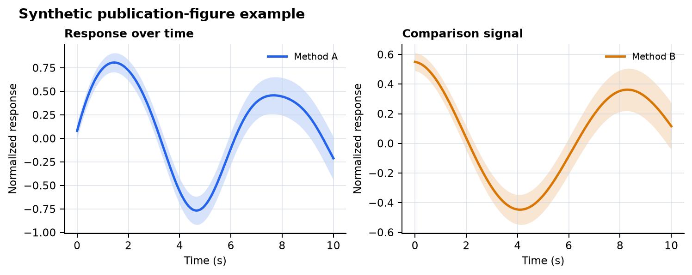

# Codex Research Kit

面向科研、数学与工程工作的可移植 Codex 配置：一个轻量全局约定、一个主流程入口、按任务加载的专业 skill、出版级科研绘图方法，以及可选的 Tavotto 图形精修组件。

> 这是个人工作流的公开版。它不包含公司加密工作站规则、模型配置、账号状态、会话记录、私有项目、MATLAB 安装或宿主插件缓存。

## 工作流总览





主流程先决定需要的能力，再加载最窄的专业 skill。工具、MCP、插件、CLI 和软件以目标设备实际可调用状态为准；缺少可选能力时继续可行路线，必需能力受阻时明确指出受阻环节。

## 公开内容

| 目录 | 作用 |
|---|---|
| `AGENTS.md` | 中文沟通、工具选择、验证、交付物表达和隐私边界 |
| `skills/research-to-deliverable` | 唯一主入口；组织研究、推导、计算、协作、专业 skill 路由和交付整合 |
| `skills/publication-figures` | 数据图、误差、不确定性、多面板布局、可编辑导出与成品检查 |
| `skills/docling` | 复杂 PDF、扫描资料、章节、表格和图注的结构提取 |
| `skills/technical-presentations` | 证据到页面、技术讲述、可编辑演示和真实渲染检查 |
| `third_party/tavotto` | 可选 AGPL-3.0 图形交互精修组件，保留上游源文件和许可证 |
| `docs/` | 工具链模板、可选能力目录、第三方来源和公开说明 |
| `examples/` | 合成数据图和架构图源文件，可重建 README 示例 |

当前公开版包含许可清晰的研究方法 skill；`docx`、`pdf`、`pptx`、`xlsx` 等宿主专用或有独立许可的能力不复制进来，MathWorks 领域 skill 也保留为目标设备的可选能力。目标设备可以按自身许可和工具链另行安装。

## 快速开始

### 安装到本机 Codex

在 Windows PowerShell 中：

```powershell
Set-ExecutionPolicy -Scope Process Bypass
.\install.ps1
```

已有个人配置需要覆盖时：

```powershell
.\install.ps1 -Force
```

安装脚本会写入 `AGENTS.md` 和本仓库内声明的公开 skills，并在覆盖前备份目标文件。安装后重启 Codex 并启动新对话。

### 新对话使用

```text
$research-to-deliverable
根据当前材料完成这个科研/数学/工程任务，按任务自动选择专业 skill、工具和交付格式，并检查最终成品。
```

也可以直接描述任务。主流程的 description 支持隐式匹配；显式调用适合需要固定入口或希望读者看到工作流的场景。

## 专业路由

| 任务信号 | 主流程选择 | 典型工具或后端 | 交付检查 |
|---|---|---|---|
| 当前事实、论文、标准、技术文档 | `research-lookup` / `literature-review` | 原生网络、学术连接器、论文数据库 | 原文、引用链、来源范围 |
| 定义、证明、量纲、模型条件 | 数学建模参考 | SymPy、MATLAB Symbolic、Wolfram（若可用） | 假设、定义域、单位、关键性质 |
| 数据探索、统计、仿真和优化 | 计算实验参考 | Python、MATLAB、R、Jupyter、项目环境 | 数据变换、参数、随机性、数值结果 |
| 论文图、工程图、多面板图 | `publication-figures` | Python、MATLAB、R、矢量编辑器、Tavotto | 单位、误差、物理尺寸、字体、最终渲染 |
| 复杂 PDF、扫描资料和图表关系 | `docling` | Docling、PDF/PyMuPDF、OCR | 页数、图表、公式、原页回查 |
| PPTX、技术汇报和讲稿 | `technical-presentations` | PPTX/PowerPoint 或目标平台工具 | 可编辑性、页序、证据图、真实渲染 |
| LaTeX、Quarto、Pandoc、PDF | 正式交付参考 | XeLaTeX/LuaLaTeX、Quarto、Pandoc、Typst | 交叉引用、字体、分页、最终文件 |
| MATLAB/Simulink | 领域 skill | MATLAB、Simulink MCP、`matlab-control` | 会话状态、仿真结果、源代码和输出 |

完整的设备入口写入项目自己的 `docs/toolchain-profile.md`，不要把本机路径写入全局 skill。

## 出版级科研图示例



从源数据到图形成品的质量循环：


示例使用固定随机种子的合成数据，不代表具体研究结果。脚本位于 `examples/synthetic_publication_figure.py`，可在装有 Matplotlib 的 Python 环境中重建。

## 文献到演示


复杂文献先按需要提取结构，决定结论的图、表、公式和单位回查原页，再由技术演示 skill 组织证据到页面。中间提取结果不自动变成正式交付物。

## 工具和插件边界

- 公开仓库提供方法和路由，不把软件安装状态当成工具可用性。
- `docs/toolchain-profile.md` 是可填写模板；Quarto、Pandoc、TeX Live、Typst、MATLAB、Office、OCR 和浏览器均由目标设备单独验证。
- `third_party/tavotto` 采用上游 AGPL-3.0，和本仓库的 MIT 内容分开授权。需要运行时请按其 README 配置，不把缓存、会话数据库和测试输出复制进仓库。
- 宿主自带的 proprietary skill、连接器认证、`config.toml`、模型目录、令牌、会话、日志和个人文献库不在仓库中。

## 质量与复现

- 保留数据源、脚本、参数、环境声明和最终文件之间的关系。
- 按错误模式做关键检查，区分证明、数值实验、仿真和实测。
- 图表保留生成后端和可编辑源；矢量精修不替代数据重算。
- 正式交付物只呈现目标读者需要的内容；过程日志和内部检查记录放在独立工作区。

## 许可与来源

本仓库原创配置与文档采用 [MIT License](LICENSE)。第三方内容和上游方法参考见 [THIRD_PARTY_NOTICES.md](THIRD_PARTY_NOTICES.md)，其原始许可证继续有效。

- [OpenAI Agent Skills](https://developers.openai.com/api/docs/guides/tools-skills)
- [OpenAI skill creator](https://github.com/openai/skills/tree/main/skills/.system/skill-creator)
- [Tavotto](https://github.com/Tavotto/Tavotto)
- [Docling](https://github.com/docling-project/docling)
- [Quarto](https://quarto.org/)

## 不包含的内容

公司迁移包、公司加密规则、内部工程项目、MATLAB R2024a 离线安装资产、账户配置、认证状态、模型上下文覆盖、私人会话、缓存、日志、附件、浏览器状态和任何用户数据均不在本公开仓库中。


